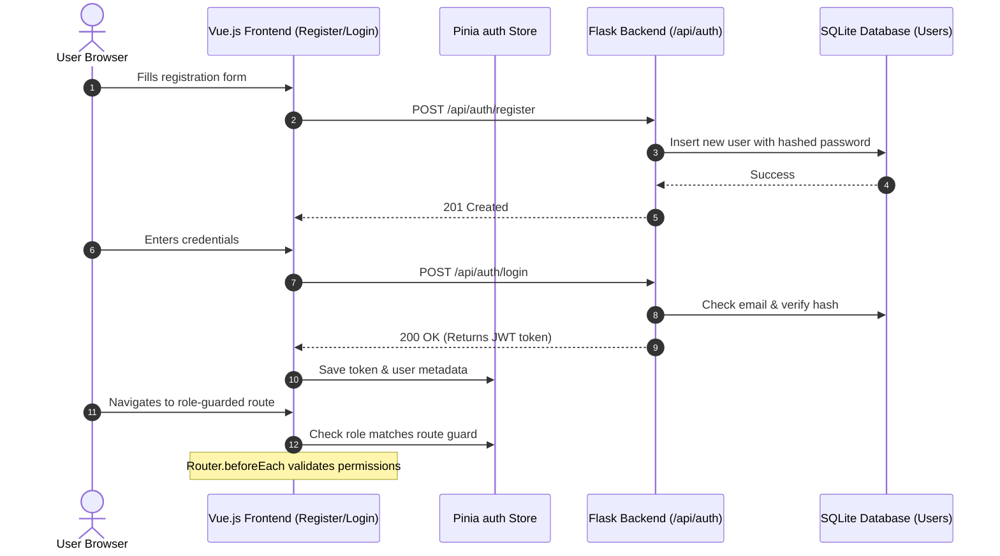

# Integration Test Scenario: Authentication and Session Flow

## Overview
This integration scenario validates the end-to-end user path from initial sign-up to logging in and secure, role-restricted page access.

## Flow Steps & Components Involved

### 1. User Registration
* **Frontend View:** [Register.vue](file:///c:/Users/nithi/OneDrive/Desktop/Projects/SE_P/MAY2026-Team-034/frontend/src/views/Register.vue)
* **Backend Endpoint:** `POST /api/auth/register` (in [auth.py](file:///c:/Users/nithi/OneDrive/Desktop/Projects/SE_P/MAY2026-Team-034/backend/app/routes/auth.py))
* **Verification:** Check that a new user record with appropriate default role is created in the database.

### 2. User Authentication
* **Frontend View:** [Login.vue](file:///c:/Users/nithi/OneDrive/Desktop/Projects/SE_P/MAY2026-Team-034/frontend/src/views/Login.vue)
* **Backend Endpoint:** `POST /api/auth/login` (in [auth.py](file:///c:/Users/nithi/OneDrive/Desktop/Projects/SE_P/MAY2026-Team-034/backend/app/routes/auth.py))
* **Verification:** Retrieve the JWT access token and user claims. Ensure the Axios client defaults are updated with the authorization header.

### 3. Session Persistence & Token Handling
* **Frontend Store:** `frontend/src/stores/auth.js`
* **Verification:** Ensure that page refreshes do not clear the user session unless the token expires or [LogoutModal.vue](file:///c:/Users/nithi/OneDrive/Desktop/Projects/SE_P/MAY2026-Team-034/frontend/src/components/LogoutModal.vue) is triggered.

### 4. Role-based Route Guard Integration
* **Frontend Router:** `frontend/src/router/index.js`
* **Verification:** 
  * Attempt to access a student view using a faculty token (should permit access if correct, or block if role mismatch).
  * Attempt to access an admin view using a student token (should redirect to `/unauthorized` or `/login`).
