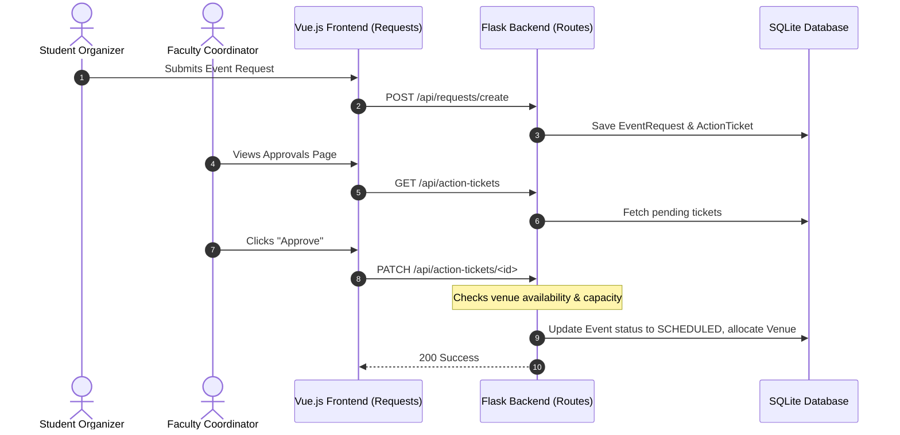

# Integration Test Scenario: Event Booking and Venue Allocation Flow

## Overview
This scenario validates the interaction when a student organizer requests to book an event at a specific venue, generating approval tickets for administrative staff and updating booking logs on approval.

## Flow Steps & Components Involved

### 1. Request Creation
* **Frontend View:** [Requests.vue](file:///c:/Users/nithi/OneDrive/Desktop/Projects/SE_P/MAY2026-Team-034/frontend/src/views/student/Requests.vue)
* **Backend Endpoint:** `POST /api/requests/create` (in [requests.py](file:///c:/Users/nithi/OneDrive/Desktop/Projects/SE_P/MAY2026-Team-034/backend/app/routes/requests.py))
* **Verification:** Verify that an `EventRequest` record is added to the database along with a corresponding `ActionTicket` routed to the club's assigned Faculty Coordinator.

### 2. Approval Request Dashboard Routing
* **Frontend View:** [faculty/Requests.vue](file:///c:/Users/nithi/OneDrive/Desktop/Projects/SE_P/MAY2026-Team-034/frontend/src/views/faculty/Requests.vue)
* **Backend Endpoint:** `GET /api/action-tickets` (in [action_tickets.py](file:///c:/Users/nithi/OneDrive/Desktop/Projects/SE_P/MAY2026-Team-034/backend/app/routes/action_tickets.py))
* **Verification:** Ensure that only the designated faculty supervisor (or system administrator) can view and modify the generated action ticket.

### 3. Allocation and Validation Checks
* **Backend Services:** `backend/app/routes/venues.py` & `backend/app/routes/events.py`
* **Verification:** 
  * Ensure that if the venue's capacity is lower than the requested event capacity, the backend rejects allocation with a `400 Bad Request`.
  * Ensure that if the venue has another overlapping approved event, the backend prevents duplicate booking.

### 4. Status Update and Allocation Persistence
* **Backend Endpoint:** `PATCH /api/action-tickets/<id>/status` (in [action_tickets.py](file:///c:/Users/nithi/OneDrive/Desktop/Projects/SE_P/MAY2026-Team-034/backend/app/routes/action_tickets.py))
* **Verification:** On approval, the event status changes from `PENDING` $\rightarrow$ `APPROVED` or `SCHEDULED`, and the venue is marked as occupied for the requested slot.
