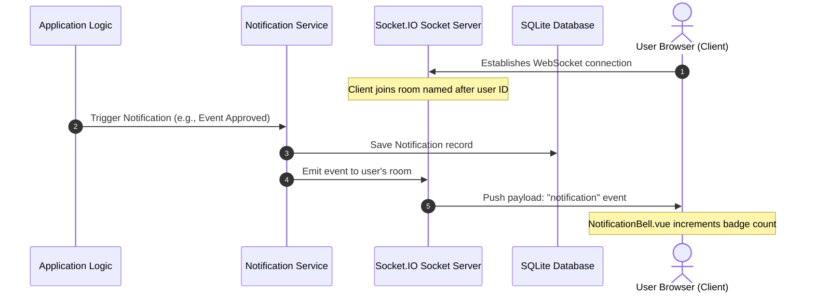

# Integration Test Scenario: Real-Time Notifications Flow

## Overview
This scenario validates that system-triggered notifications (e.g., event approvals, role request updates) are processed in the backend, saved to the database, and pushed to active client browsers in real-time via Socket.IO.

## Flow Steps & Components Involved

### 1. Client WebSocket Handshake
* **Frontend View:** [NotificationBell.vue](file:///c:/Users/nithi/OneDrive/Desktop/Projects/SE_P/MAY2026-Team-034/frontend/src/components/NotificationBell.vue)
* **Backend Socket Handler:** [notification_socket.py](file:///c:/Users/nithi/OneDrive/Desktop/Projects/SE_P/MAY2026-Team-034/backend/app/sockets/notification_socket.py)
* **Verification:** Ensure that on frontend mounting, a WebSocket handshake is completed successfully and the client joins a socket room named `user_<user_id>`.

### 2. Notification Dispatch
* **Backend Service:** [notification_service.py](file:///c:/Users/nithi/OneDrive/Desktop/Projects/SE_P/MAY2026-Team-034/backend/app/services/notification_service.py)
* **Verification:** When an event changes status or a ticket is actioned:
  * A record is written to the `Notification` database table.
  * `notification_service.send_notification(user_id, title, message, type)` is called.

### 3. Socket Broadcasting
* **Backend Event:** Sockets emit the payload to the specific user's namespace (`/notifications`).
* **Verification:** Check that Socket.IO delivers the frame to the client matching the target `user_id` only (e.g., other users do not receive this notification frame).

### 4. UI Rendering and Inbox Updating
* **Frontend Views:** [Notifications.vue](file:///c:/Users/nithi/OneDrive/Desktop/Projects/SE_P/MAY2026-Team-034/frontend/src/views/Notifications.vue) and [useNotifications.js](file:///c:/Users/nithi/OneDrive/Desktop/Projects/SE_P/MAY2026-Team-034/frontend/src/stores/useNotifications.js)
* **Verification:** 
  * Ensure the bell icon badge increments reactive count in the UI.
  * Clicking the notification opens the detailed [NotificationsView.vue](file:///c:/Users/nithi/OneDrive/Desktop/Projects/SE_P/MAY2026-Team-034/frontend/src/views/NotificationsView.vue) and marks the notification as `READ` via a `PATCH` request to the backend.
